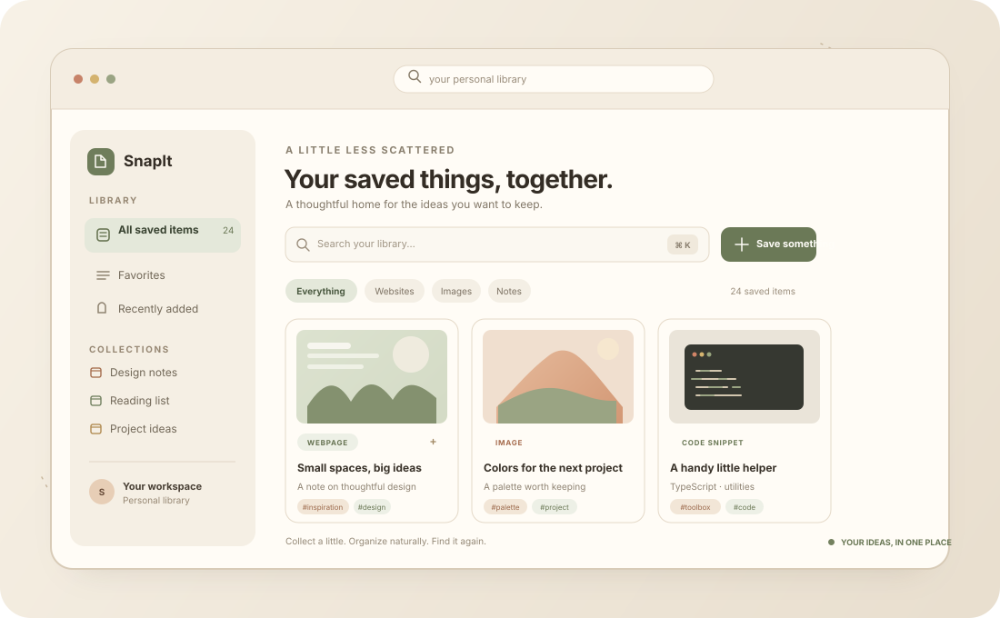

<div align="center">

<h1>SnapIt</h1>

<p><strong>A calmer home for everything you want to remember.</strong></p>

<p>
  Save useful webpages, images, PDFs, notes, and code snippets in one personal library.
  Add context, keep things organized, and find them again when you need them.
</p>

<p>
  
  
  
  
</p>

<p><em>Live frontend on Vercel · API on Render · PostgreSQL on Neon</em></p>



<sub>Illustrative product overview, not a screenshot of the live application.</sub>

</div>

## What is SnapIt?

Useful things get scattered across browser tabs, screenshots, documents, and chats. SnapIt brings them together in a searchable, personal workspace.

## Features

- **Save different kinds of things:** webpages, images, PDFs, text notes, and code snippets.
- **Search your library:** find saved items by their available text and details.
- **Add context:** use descriptions, tags, and collections to make references easier to revisit.
- **Keep favorites close:** mark important items and browse them separately.
- **Extract text from uploads:** the backend processes text in images and PDFs.
- **Make it yours:** choose a light or dark theme and adjust your workspace.
- **Use your own account:** register and sign in to a JWT-secured API.

## Tech stack

| Area | Technologies |
| --- | --- |
| Frontend | React, TypeScript, Vite, React Router |
| Backend | Java 21, Spring Boot, Spring Data JPA, Spring Security, JWT |
| Database | PostgreSQL on Neon; Flyway-managed schema |
| Hosting | Vercel (frontend), Render (API), Neon (database) |
| Document processing | Apache PDFBox, Tesseract OCR |

## Run locally

### Prerequisites

- Node.js and npm
- Java 21
- A PostgreSQL database
- Maven, or the included Maven Wrapper

### Frontend

From the repository root:

```bash
npm --prefix frontend install
npm --prefix frontend run dev
```

Vite starts at `http://localhost:5173`.

### Backend

Set the backend environment variables before starting Spring Boot:

| Variable | Purpose |
| --- | --- |
| `DATABASE_URL` | PostgreSQL connection URL. The app accepts Neon’s `postgresql://` URL. |
| `DATABASE_URL_UNPOOLED` | Optional direct PostgreSQL URL for Flyway migrations. |
| `DB_URL` | Optional JDBC URL override, such as `jdbc:postgresql://localhost:5432/snapitDB`. |
| `DB_USERNAME` / `DB_PASSWORD` | Optional credentials for a local database or a URL without embedded credentials. |
| `SNAPIT_JWT_SECRET` | Secret used to sign access tokens. Set a private value locally; never commit it. |
| `PORT` | Optional server port; defaults to `8080`. |

Then run the backend from the `backend` directory:

```powershell
.\mvnw.cmd spring-boot:run
```

On macOS or Linux:

```bash
./mvnw spring-boot:run
```

The API defaults to `http://localhost:8080`. When using Neon locally, the CLI can inject the linked branch’s database URLs:

```bash
npx neon-env run -- ./backend/mvnw spring-boot:run
```

On Windows, run `npx neon-env run -- .\backend\mvnw.cmd spring-boot:run`. Set `SNAPIT_JWT_SECRET` in that terminal first. The backend applies its Flyway migration at startup; use a development database when testing schema changes.

## Deployments

The production setup uses Vercel for the frontend, Render for the Spring Boot API, and Neon for PostgreSQL. See [DEPLOYMENT.md](DEPLOYMENT.md) for deployment steps, environment variables, and hosting limitations.

## Project layout

```text
.
├── backend/                 # Spring Boot API and database migrations
├── docs/                    # README artwork
├── frontend/                # React + TypeScript web application
├── render.yaml              # Render API service blueprint
└── DEPLOYMENT.md            # Deployment guide
```

## Development notes

- Keep database URLs, passwords, and JWT secrets out of source control.
- Uploaded files are stored on the API server’s local filesystem. On Render’s free service, local files are ephemeral; use persistent object storage if uploads must survive restarts or redeploys.
- Collections and profile/preferences are currently stored in the browser, so they are not yet synchronized between devices.
